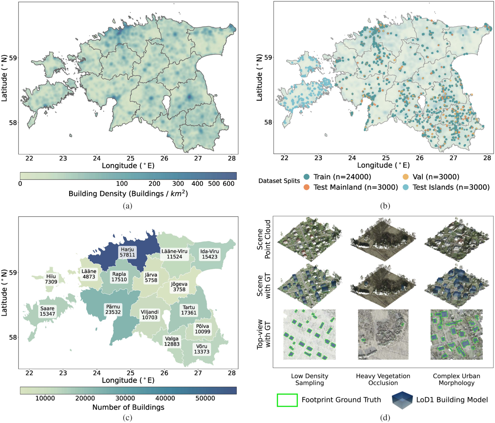

# PCFootprint

**PCFootprint: A Large-Scale Dataset and Benchmark for Vectorized Building Footprint Extraction From Aerial LiDAR Point Clouds**

Haoyuan Shen†, Kuihao Wang†, Ruisheng Wang*, Yujun Liu*

School of Architecture and Urban Planning, Shenzhen University

† Equal contribution. * Corresponding authors.

Published in **IEEE Journal of Selected Topics in Applied Earth Observations and Remote Sensing (JSTARS)**, vol. 19, pp. 26525–26539, 2026.

[Paper](https://doi.org/10.1109/JSTARS.2026.3715686) · [Dataset](https://huggingface.co/datasets/Haoyuan-Shen/PCFootprint)

## Overview

PCFootprint is a large-scale public dataset and benchmark for vectorized building footprint extraction from aerial laser scanning (ALS) point clouds. It provides aligned polygon annotations across diverse urban and rural landscapes in Estonia, together with a geographically distinct test set for evaluating cross-domain generalization.



## Dataset

| Property | Details |
| --- | --- |
| Point cloud tiles | 33,000 |
| Building instances | 227,264 |
| Geographic coverage | 540.67 km² |
| Tile extent | 128 × 128 m |
| Data type | ALS point clouds |
| Annotations | Vectorized polygons in MS-COCO format |
| Point spacing | 0.22–1.09 m |

The **Mainland** subset contains 24,000 training, 3,000 validation, and 3,000 test tiles. The **Islands** subset contains 3,000 geographically distinct test tiles from Saaremaa and Hiiumaa for zero-shot evaluation.

Download the dataset and consult the release details on [Hugging Face](https://huggingface.co/datasets/Haoyuan-Shen/PCFootprint). This repository contains the project website and accompanying paper figures.

## Citation

If you use PCFootprint in your research, please cite:

```bibtex
@article{shen2026pcfootprint,
  title   = {PCFootprint: A Large-Scale Dataset and Benchmark for
             Vectorized Building Footprint Extraction From
             Aerial LiDAR Point Clouds},
  author  = {Shen, Haoyuan and Wang, Kuihao and Wang, Ruisheng
             and Liu, Yujun},
  journal = {IEEE Journal of Selected Topics in Applied Earth
             Observations and Remote Sensing},
  volume  = {19},
  pages   = {26525--26539},
  year    = {2026},
  doi     = {10.1109/JSTARS.2026.3715686}
}
```

## License and Acknowledgements

The paper and dataset are licensed under [Creative Commons Attribution 4.0 International (CC BY 4.0)](https://creativecommons.org/licenses/by/4.0/). Figures in this repository are reproduced from the paper.

We thank the Estonian Land and Spatial Development Board for the open LiDAR and geospatial data used to develop PCFootprint. See the dataset card for original data attribution and licensing details.
